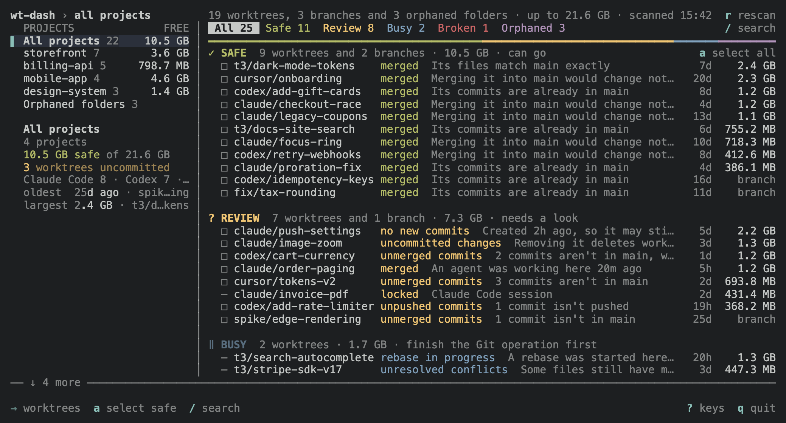
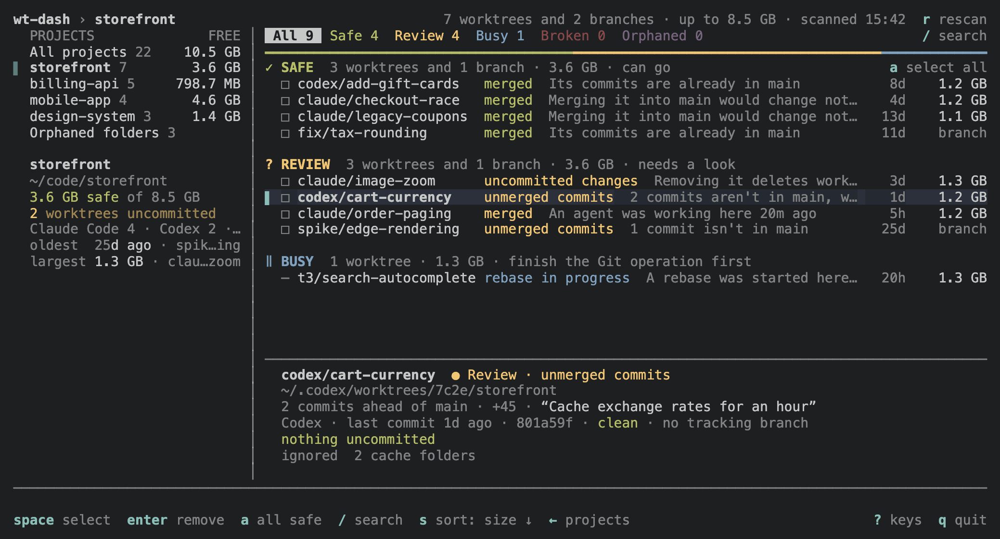
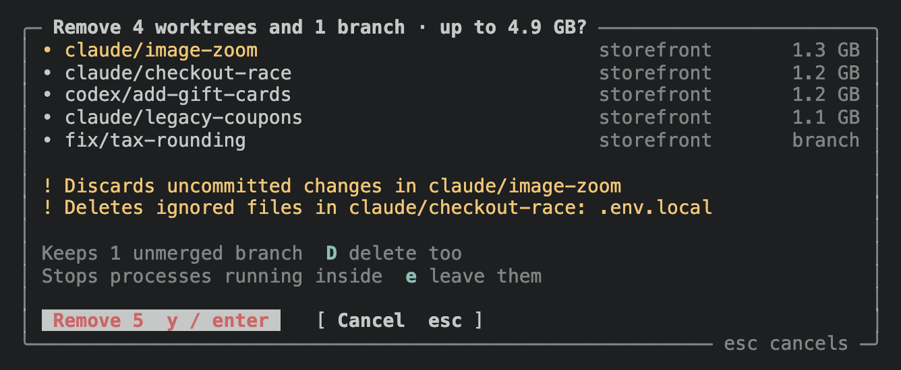
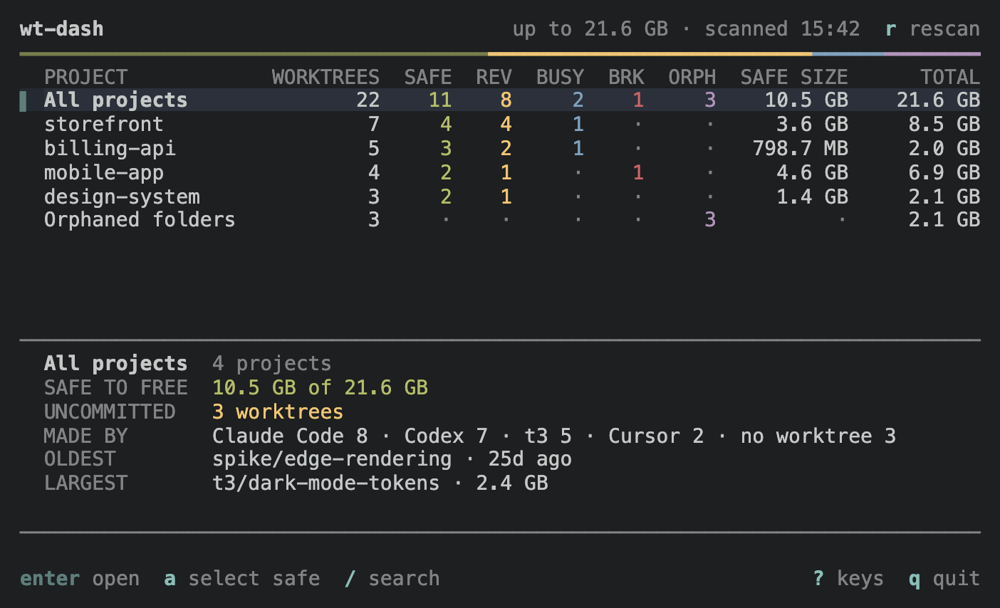

# wt-dash

A terminal dashboard for finding and removing the Git worktrees you no longer need, across every repository on your Mac or Linux machine.



Coding agents such as Claude Code, Codex, Cursor and t3 create a worktree for each task, each with its own `node_modules`, and nothing removes them afterwards. wt-dash lists every worktree with its size and Git state, sorts them by how safe they are to delete, and removes the ones you pick in one go. It uses [Worktrunk](https://worktrunk.dev/) for the Git checks and the removals.

## Install

```sh
brew install rigomart/tap/wt-dash
```

This installs [Worktrunk](https://worktrunk.dev/) too. wt-dash needs Git and Worktrunk 0.80.0 or newer, and runs on macOS 13 or newer (Apple Silicon and Intel) and on Linux with glibc (arm64 and x64). Alpine and other musl-based distributions are not supported; `ldd --version` prints "GNU libc" on a glibc system. Where Homebrew has no prebuilt Worktrunk, which includes Intel Macs and Linux, it compiles Worktrunk from source, which takes a few minutes.

To install without Homebrew, download the archive for your system from the [latest release](https://github.com/rigomart/wt-dash/releases/latest) and put the `wt-dash` executable in a folder on your PATH. The macOS binary is not signed or notarized, so macOS blocks a copy downloaded with a browser until you allow it under System Settings → Privacy & Security.

<details>
<summary>Linux without Homebrew, step by step</summary>

1. Install Worktrunk with `cargo install worktrunk`, with `sudo pacman -S worktrunk` on Arch Linux, or from a [Worktrunk release](https://github.com/max-sixty/worktrunk/releases).
2. Download the archive for your processor from the [latest release](https://github.com/rigomart/wt-dash/releases/latest): `linux-x64` if `uname -m` prints `x86_64`, `linux-arm64` if it prints `aarch64`.
3. Extract it, put `wt-dash` on your PATH, and check the setup:

```sh
tar -xzf wt-dash-v*-linux-x64.tar.gz
mkdir -p ~/.local/bin
mv wt-dash ~/.local/bin/
wt-dash --doctor ~/projects
```

If your shell can't find `wt-dash`, add `~/.local/bin` to your PATH.

</details>

## Quick start

1. **Run it.**

   ```sh
   wt-dash
   ```

   With no folders, wt-dash scans `~/projects`, `~/code`, `~/dev`, `~/src` and `~/work`, and follows the worktrees in coding agents' folders, such as `~/.codex/worktrees`, back to their repositories. To scan somewhere else, name the folders: `wt-dash ~/repos`. `wt-dash --doctor` shows what it finds without opening the dashboard.

2. **Read the verdicts.** Each worktree, and each local branch left without one, gets a verdict, with its Git status and the reason next to it. The strip under the list describes the focused row.

   

   | Verdict      | Meaning                                                                                                |
   | ------------ | ------------------------------------------------------------------------------------------------------ |
   | **Safe**     | Its work is already in the default branch. Remove it.                                                  |
   | **Review**   | Something would be lost or may still be in use, such as uncommitted or unpushed work, or it is locked. |
   | **Busy**     | A rebase, merge or cherry-pick is in progress, or conflicts are unresolved. Can't be removed.          |
   | **Broken**   | Its folder is gone but Git still lists it. wt-dash offers to prune the record.                         |
   | **Orphaned** | A worktree folder that no repository knows about any more.                                             |

3. **Select and remove.** Press `enter` to open a project, or "All projects". Press `a` to select every Safe row, or `space` to pick rows one at a time, then `enter`. From the projects, `a` then `x` does the same for the focused project. The dialog lists what goes, how much space it frees, and what would be lost. Press `y` or `enter` to remove, `esc` to cancel.

   

   Removals run in the background, so you can keep working and queue more.

## Keys

| Key        | Action                                                                     |
| ---------- | -------------------------------------------------------------------------- |
| ↑ ↓ or j k | Move                                                                       |
| enter or → | Open the focused project, or "All projects"                                |
| ← or tab   | Back to the projects                                                       |
| 1–6        | Show all, Safe, Review, Busy, Broken or Orphaned rows                      |
| /          | Search by repo, branch, tool or path                                       |
| space      | Select the focused row                                                     |
| a          | Select every Safe row in view, or in the focused project                   |
| enter or x | In a list, remove the selection or the focused row                         |
| i          | Show every detail of the focused row                                       |
| esc        | Step back: clear the search, selection or tab, then return to the projects |
| r          | Rescan every repository                                                    |
| ?          | Show every key                                                             |
| q          | Quit                                                                       |

<details>
<summary>Every key, by screen</summary>

On the projects:

| Key                | Action                                                  |
| ------------------ | ------------------------------------------------------- |
| ↑ ↓ or j k         | Move                                                    |
| pgup pgdn, g G     | Move a page, or to the first or last project            |
| enter, →, l or tab | Open the focused project, or every project together     |
| /                  | Search every project by repo, branch, tool or path      |
| a                  | Select every Safe row in the focused project, or in all |
| x                  | Remove the selection                                    |
| esc                | Clear the selection, then stop a running removal        |

In a worktree list:

| Key            | Action                                                                                               |
| -------------- | ---------------------------------------------------------------------------------------------------- |
| ↑ ↓ or j k     | Move                                                                                                 |
| pgup pgdn, g G | Move a page, or to the first or last row                                                             |
| 1–6            | Show all, Safe, Review, Busy, Broken or Orphaned                                                     |
| ←, h or tab    | Back to the projects                                                                                 |
| [ / ]          | Previous / next project                                                                              |
| /              | Search by repo, branch, tool or path                                                                 |
| space          | Select the focused row                                                                               |
| a              | Select every Safe row in view                                                                        |
| enter or x     | Remove the selection, or the focused row; with nothing selected, prune a focused Broken row's record |
| i              | Show full details for the focused row                                                                |
| s / S          | Change the sort (size, age, repo) / reverse it                                                       |
| v              | Group by verdict or by repo ("All projects" only)                                                    |
| R              | Remeasure the focused worktree                                                                       |
| esc            | Step back: clear the search, selection or tab, then return to the projects                           |

In the remove dialog:

| Key        | Action                                           |
| ---------- | ------------------------------------------------ |
| y or enter | Remove                                           |
| D          | Delete unmerged branches too                     |
| e          | Leave the processes running inside each worktree |
| esc or n   | Cancel                                           |

Everywhere, `r` rescans every repository, `?` shows every key, and `q` or `ctrl+c` quits. Selections carry across screens.

</details>

## Reference

### Verdicts

| Verdict      | Status                                                                                                                                                       | Removal                             |
| ------------ | ------------------------------------------------------------------------------------------------------------------------------------------------------------ | ----------------------------------- |
| **Safe**     | no new commits, merged                                                                                                                                       | Allowed                             |
| **Review**   | uncommitted changes, unpushed commits, unmerged commits, behind main, unrelated history; no new commits, under a day old; an agent marked it in the last day | Allowed after you read the warning  |
| **Review**   | locked, status unknown                                                                                                                                       | Blocked                             |
| **Busy**     | rebase, merge, or cherry-pick in progress; unresolved conflicts                                                                                              | Blocked                             |
| **Broken**   | folder missing                                                                                                                                               | Offers to prune Git's record        |
| **Orphaned** | repository gone, unknown to its repo, Git record gone; no worktree inside                                                                                    | Allowed; wt-dash deletes the folder |

A blocked row says what to do next, for example "finish or abort the rebase first". A lock blocks removal however old it is; unlock a stale one with `git worktree unlock`.

<details>
<summary>When a worktree counts as Safe</summary>

Safe means Worktrunk reports clean content that is already in the default branch, or identical to it. A new worktree whose branch has nothing beyond the default branch looks the same way, so, like `wt step prune`, wt-dash calls it Safe only once it is a day old. Until then it is Review, with a reason such as "Created 2h ago, so it may still be in use", and `a` leaves it out. Its age comes from when Git created its folder under `.git/worktrees`; if that can't be read, it stays Review. A branch whose own commits reached the default branch through a squash or rebase merge is Safe at any age.

wt-dash also reads agent marks. Worktrunk's agent plugins, such as the one `wt config plugins claude install` adds, mark a branch 🤖 while an agent works in it and 💬 while it waits for input, and clear the mark when the session ends. A worktree that would be Safe but has a mark set in the last day is Review instead, with a reason such as "An agent was working here 20m ago"; you can still remove it. A mark whose time can't be read counts as recent. An older mark is probably left from a session that didn't end cleanly, so it only shows in the details, as "Agent mark from 28d ago, likely stale". Marks belong to a branch name, so renaming a branch drops its mark.

Running processes don't change a verdict. After each scan the strip shows the processes whose working directory is inside a worktree, with the TCP ports they listen on, such as `2 processes · :3000 :5173`, and `i` lists each one's command. A process that holds a terminal, such as a shell or a terminal editor, reads `zsh (terminal)`. The remove dialog names the worktrees that have one.

wt-dash does not check pull request status.

</details>

### Orphaned folders

Git and Worktrunk find a worktree only through its repository, so a worktree folder whose link to its repository broke is invisible to both. wt-dash looks for these in the folders agents keep worktrees in: `.claude/worktrees` inside each scanned repository, `~/.codex/worktrees`, and t3's `~/.t3/worktrees` and `~/.t3-lines/lines/worktrees`. They are listed under "Orphaned folders", last on the projects screen and in "All projects", with their size and the reason:

- The repository was deleted or moved: "Its repository at ~/old/app no longer exists."
- The repository is still there but no longer records the worktree, for example after a re-clone or a prune: "Its repository at ~/code/app no longer lists it."
- A Codex folder (`~/.codex/worktrees/<id>`) that holds only its `.codex-worktree-name` file, left behind when its worktree was removed.

<details>
<summary>Moved repositories and other details</summary>

A worktree whose link to its repository still works is never listed, wherever that repository lives. Moving a repository breaks that link but keeps its record of the worktree: if the repository is in a scanned folder, its worktrees are not listed, and `git worktree repair` run in it fixes them; if it lives elsewhere, wt-dash can't see the record and lists them as orphaned. When a scanned repository's records can't be read, the folders they might hold are left out rather than offered for deletion.

Rows are named by their folder and the one above it, such as `abcd/app` for `~/.codex/worktrees/abcd/app`. `a` selects Safe rows only, so it never selects an orphaned folder.

</details>

### Branches without a worktree

Removing a worktree often leaves its branch behind. wt-dash lists these local branches too, other than the default branch. Their size column reads "branch", and they get the same verdicts:

- A branch merged into the default branch, by any route, is Safe once it is a day old. Its age comes from its oldest reflog entry, or else from when Git last wrote it; if neither can be read, it is Review.
- A branch with unmerged commits or unrelated history is Review, and is deleted only if you press `D` in the remove dialog.
- A recent agent mark makes it Review, as for a worktree.

### Which tool made a worktree

wt-dash names the tool that made each worktree from the folder it sits in. The tool shows in the details and the strip, the projects count worktrees by tool, and `/` finds a tool's worktrees by its name. Anything else, including a tool's worktrees moved to a folder of your choosing, reads "other".

| Tool         | Default folder                                                               |
| ------------ | ---------------------------------------------------------------------------- |
| Claude Code  | `<repo>/.claude/worktrees/<name>`                                            |
| Codex        | `~/.codex/worktrees/<id>/<repo>`                                             |
| t3           | `~/.t3/worktrees/<repo>/<branch>`, and the older `.t3-lines/lines/worktrees` |
| Cursor       | `~/.cursor/worktrees/…`                                                      |
| Conductor    | `~/conductor/workspaces/<repo>/<name>`                                       |
| Windsurf     | `~/.windsurf/worktrees/<repo>/<name>`                                        |
| Gemini CLI   | `<repo>/.gemini/worktrees/<name>`                                            |
| Claude Squad | `~/.claude-squad/worktrees/<name>`                                           |
| Superset     | `~/.superset/worktrees/…`                                                    |
| Worktrunk    | `<repo>.<branch>` beside the repository, Worktrunk's default `worktree-path` |

### What removal does

The dialog lists each row and its size, the total, and which ones would lose uncommitted or untracked changes or ignored files that aren't caches, such as `.env.local`.

- **Branches are kept unless they are merged.** Press `D` in the dialog to delete unmerged branches too. An unmerged branch without a worktree is skipped unless you press `D`, since deleting it is all its removal does.
- **Processes running inside are stopped**, such as dev servers, watchers and language servers, so they don't hold the folder open. The dialog names the worktrees that have some, such as `Running in feature/login: 1 process · :3000`. Worktrunk leaves interactive shells and terminal editors alone. Press `e` in the dialog to leave every process running.
- **Ignored files go with the worktree**, including `.env` copies, local databases and caches, the same way Worktrunk treats them.
- **Worktrunk hooks are skipped.** Project-defined cleanup commands do not run.
- **Orphaned folders are deleted by wt-dash**, because Worktrunk can't remove a folder no repository knows. The dialog does not check the files inside one; they go with it, and processes running inside are not stopped. Deleting a Codex worktree also deletes its `<id>` folder when nothing but the name file is left.

Each attempt is logged to `~/.cache/wt-dash/removals.log`.

<details>
<summary>What is checked again just before each removal</summary>

A worktree is skipped, and comes back with a note, if since you confirmed its Git status, commit or lock changed, it was created again at the same path, a rebase or merge started, or an agent marked it. A branch without a worktree is skipped if it moved, was deleted or now has a worktree, or if a worktree folder has the same name as the branch, because Worktrunk would remove that worktree instead. Whether a branch is merged is checked again when its repository's removals start, and again for a worktree whose default or upstream branch moved since. Worktrunk makes the final call on deleting the branch.

An orphaned folder is deleted only if it is still the folder you confirmed and still orphaned for the same reason.

</details>

### Options

```sh
wt-dash                  # scan the usual code folders and agents' worktree folders
wt-dash ~/code ~/work    # scan only these folders
wt-dash . --depth 0      # just the current repository
wt-dash --doctor         # check Git, Worktrunk and folder access without opening the dashboard
```

| Option                             | Effect                                                    |
| ---------------------------------- | --------------------------------------------------------- |
| `--depth <n>`                      | Folder levels to search below each root, 0–20 (default 2) |
| `--wt-path <path>`                 | Use a specific Worktrunk executable                       |
| `--doctor`                         | Check the setup and exit                                  |
| `-h`, `--help` / `-v`, `--version` | Show help or the version                                  |

wt-dash looks for repositories up to two folder levels below each folder (`--depth` changes this). Point it at main repositories, not linked worktrees, or at the folders that contain them. Worktrees stored elsewhere still show up, because Worktrunk lists every worktree linked to a repository wherever it lives.

Without folders, it scans `~/projects`, `~/code`, `~/dev`, `~/src` and `~/work`, each only if it exists, and follows each worktree in the agents' folders in your home folder (those in [Which tool made a worktree](#which-tool-made-a-worktree)) back to its repository, so a repository with an agent worktree shows up wherever it lives. If that finds nothing, wt-dash says which folders it scanned; `wt-dash --doctor` lists them with how many repositories each found.

### Wide and narrow terminals

At 100 columns or more, the projects sit in a sidebar and the focused project's worktrees fill the rest of the screen; → moves into the list and ← back. On narrower terminals the projects fill a table with a column per verdict, and `enter` opens one.



<details>
<summary>The details strip and the order projects load in</summary>

A worktree's strip says what it holds, such as `3 commits ahead of main · +16 · “Document the per-IP rate limits”`: its commits beyond the default branch, the lines they add and remove, and the latest one's subject. `i` adds how far the default branch has moved on since. Notes left on a branch show under that line and in `i`: its Git description (`git branch --edit-description`) and any Worktrunk vars (`wt config state vars set ticket=API-142`), which a Worktrunk hook or an agent can set when it creates the worktree.

Projects with the most worktrees come first, each with how much space its Safe worktrees take. They appear as soon as wt-dash has counted each repository's worktrees from Git's records, and each project's rows fill in as Worktrunk lists them: worktrees first, then branches without a worktree once every project's worktrees are in, since those can take most of a listing when Worktrunk's cache is cold. The first project is listed first, and the project whose worktrees took the most space at the last run second; their sizes are also measured first. If the scan finds only one project, wt-dash opens it directly.

</details>

### Good to know

- Sizes come from `du` and are cached in `~/.cache/wt-dash/sizes.json`. A worktree is measured again when its saved size is more than a day old, or when files were added or removed at the top level of the worktree or its `node_modules` folder. Press `R` to remeasure the focused worktree. Totals read "up to" because disk blocks shared between files can make `du` overstate the space you get back.
- wt-dash runs Git and Worktrunk locally. It makes no network requests of its own and never changes your Worktrunk settings.

## Contributing

See [CONTRIBUTING.md](CONTRIBUTING.md) to build from source, run the tests, refresh the README images, or cut a release.

## License

[MIT](LICENSE). Release archives include notices for bundled third-party code.
